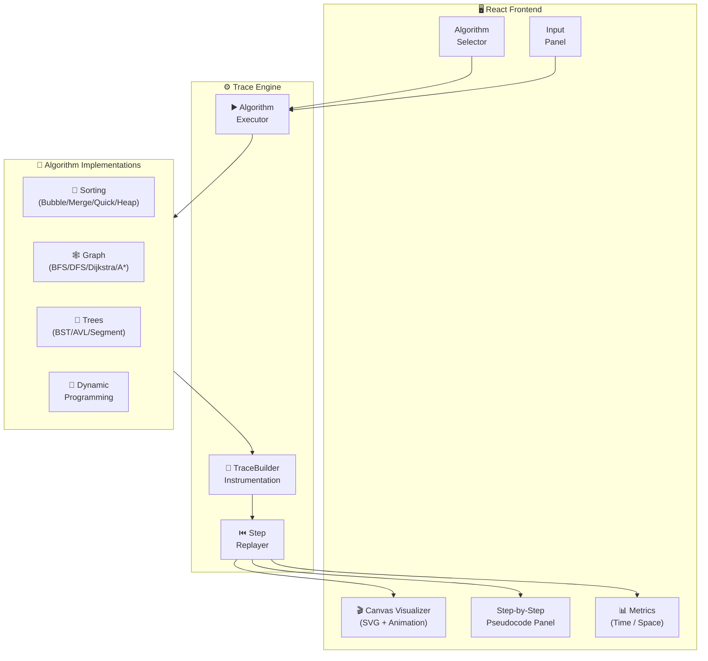
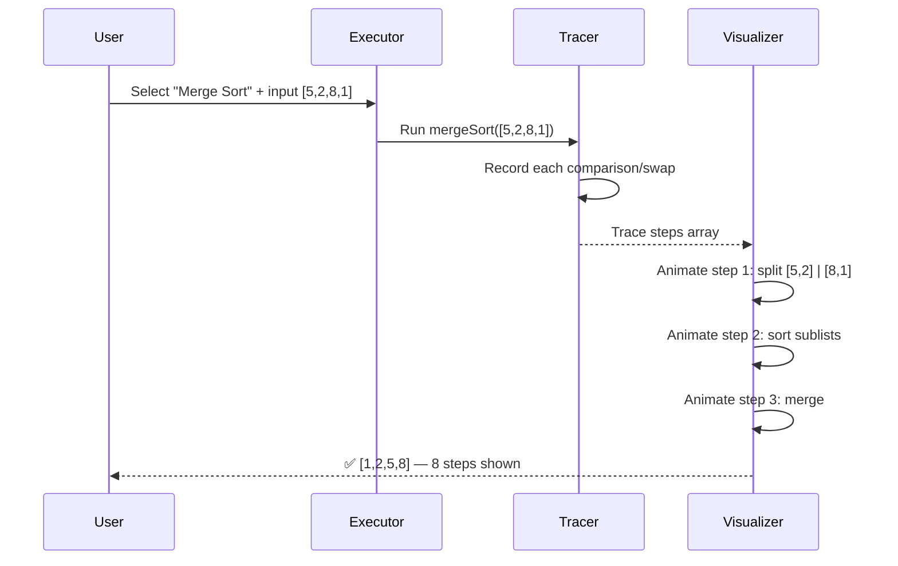

<div align="center">

# 📊 AlgoViz — Cinematic Atlas

**Execution-Level Algorithm Visualizer**

[](https://github.com/harinish45/algoviz/actions/workflows/ci.yml)
[](LICENSE)
[](https://typescriptlang.org)
[](https://vite.dev)

> *AlgoViz executes real TypeScript algorithms with trace instrumentation — every step visualized in cinematic motion*

[📋 TODO](TODO.md) · [🔍 Live Demo](#) · [📚 Docs](docs/)

</div>

---

## 🏗️ Architecture



---

## 🎬 How It Works



---

## 📊 Algorithm Coverage

| Category | Algorithms | Status |
|----------|-----------|--------|
| Sorting | Bubble, Merge, Quick, Heap, Insertion | 🔧 |
| Graph | BFS, DFS, Dijkstra, A*, Bellman-Ford | 📋 |
| Trees | BST, AVL, Red-Black, Segment | 📋 |
| Dynamic Programming | LCS, Knapsack, Coin Change | 📋 |
| Pathfinding | Maze solver, grid BFS | 📋 |

---

## 🚀 Quick Start

```bash
git clone https://github.com/harinish45/algoviz.git
cd algoviz
npm install
npm run dev   # → http://localhost:5173
```

---

<div align="center">
<a href="LICENSE">MIT License</a> · Built by harinish45
</div>